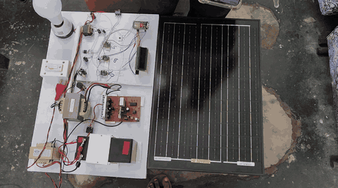
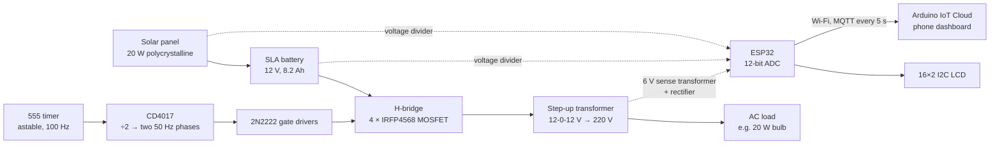
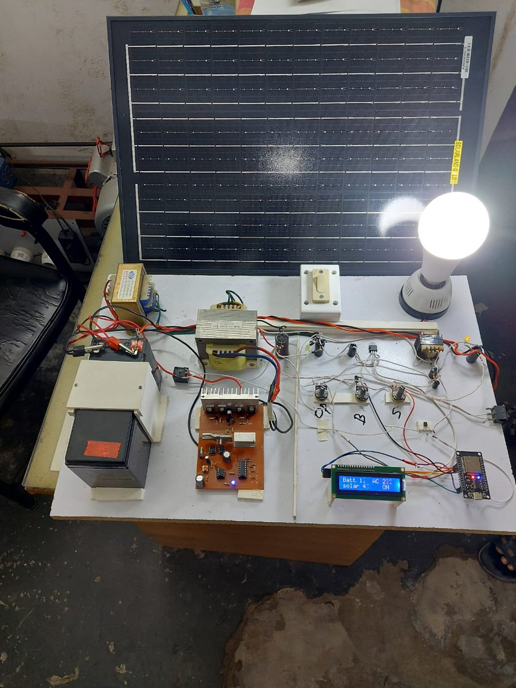
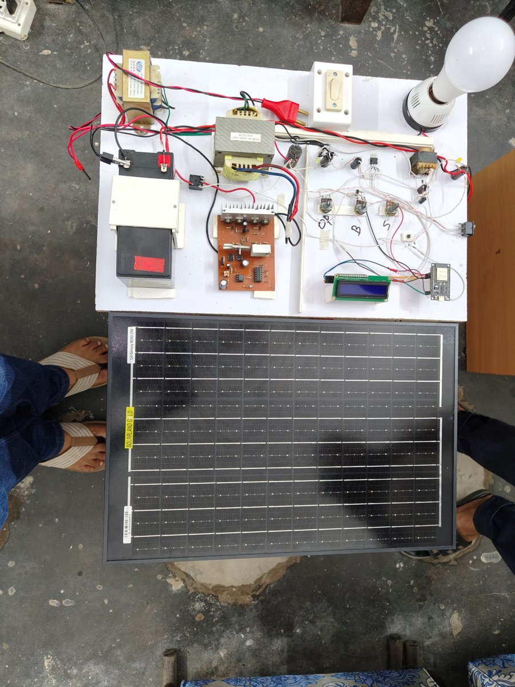
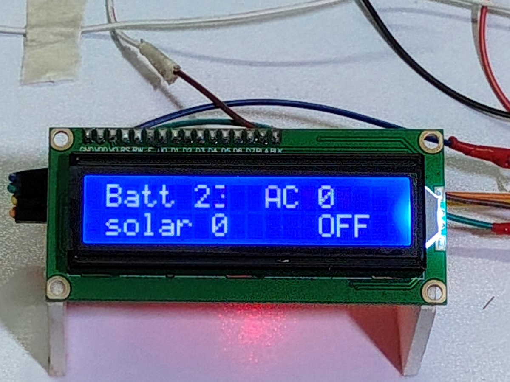
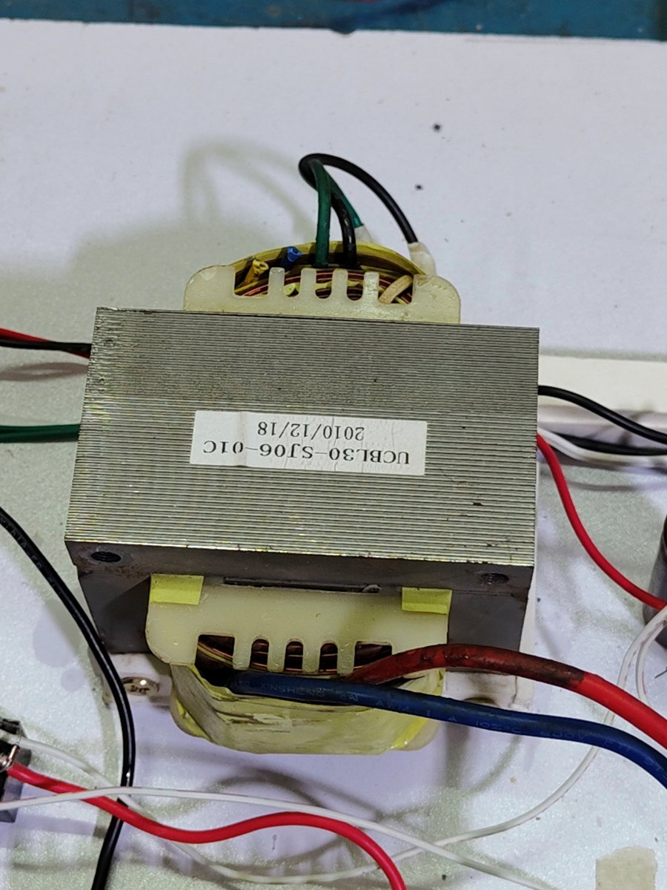
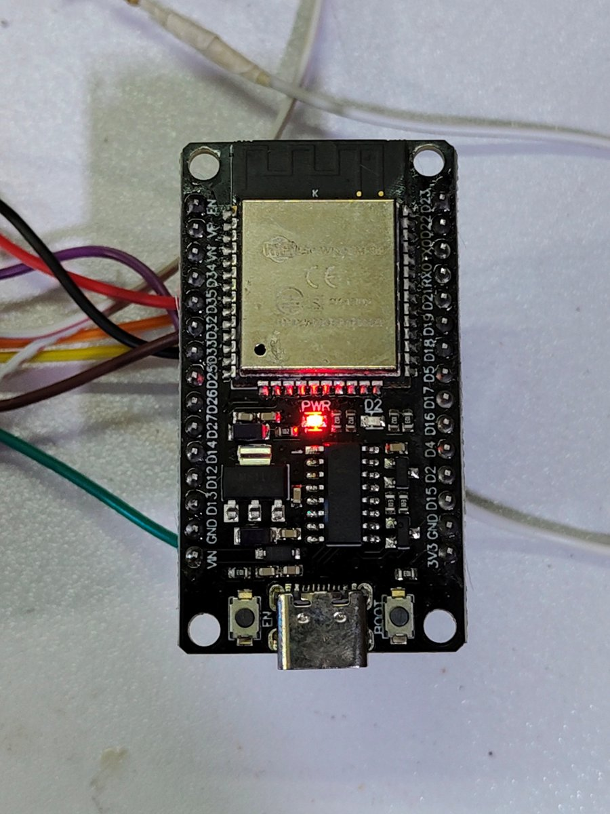
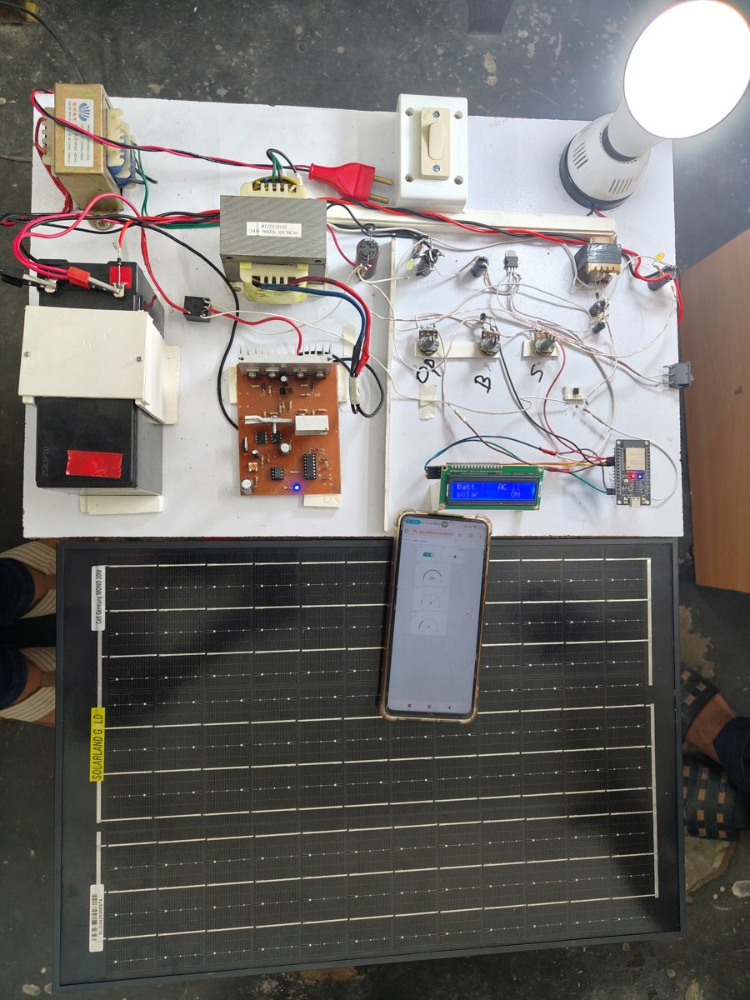

# Low-cost IoT solar inverter: square-wave single-phase UPS with ESP32 cloud monitoring

[](https://ieeexplore.ieee.org/document/11546107)


A 12 V DC to 220 V AC backup inverter for homes with frequent power cuts. A 20 W solar panel charges the battery, a discrete 555/CD4017 circuit generates the 50 Hz switching, and an ESP32 streams battery, solar and output voltage to a phone dashboard. Built for about **US$80** in parts.

Companion repository to the paper at the 2026 IEEE 2nd International Conference on Quantum Photonics, Artificial Intelligence & Networking (QPAIN). [Read the paper](https://ieeexplore.ieee.org/document/11546107)

<p align="center">
  <a href="media/inverter_demo.mp4"></a>
  <br><em>The prototype running a 20 W bulb. Click for the full 45 s video.</em>
</p>

<!-- To get an inline video player: edit this README on github.com, drag media/inverter_demo.mp4 into the editor, and replace the block above with the link GitHub generates. -->

## Why

In Bangladesh and other places with unreliable grids, load-shedding cuts power to homes, clinics and small workshops. Commercial inverters with solar input or remote monitoring cost two to three times more than basic units. This project puts all three (backup, solar, IoT monitoring) into one low-cost design.

## How it works



**Two separate paths.** The power path converts solar and battery energy to 220 V AC. The control path is split on purpose: discrete logic (555 + CD4017) generates the 50 Hz timing, so a busy or crashed microcontroller can never disturb the output. The ESP32 only measures and reports.

| Stage | Design choice |
|---|---|
| Switching | Full H-bridge, IRFP4568 MOSFETs (150 V, 171 A, 5.8 mΩ) on heat sinks, 100 Ω gate resistors |
| Timing | 555 astable at 100 Hz into a CD4017 divide-by-2, giving two complementary 50 Hz signals |
| Transformer | Custom-wound, 12-0-12 V centre-tapped primary, 220 V secondary |
| Battery sensing | 10 kΩ / 3.3 kΩ divider maps 0 to 15 V onto the ESP32's 0 to 3.3 V input |
| AC sensing | 230 V / 6 V transformer, rectifier and filter, then a 10 kΩ / 2.2 kΩ divider |
| Firmware | Arduino C++: 12-bit ADC, calibration lookup table, 100-sample averaging, Wi-Fi auto-reconnect, Arduino IoT Cloud over MQTT |

The circuit was simulated in Proteus before any hardware was built, to confirm a stable 50 Hz square wave.

## The hardware

| Complete prototype | Top view |
|---|---|
|  |  |

| Local LCD readout | Step-up transformer | ESP32 monitor |
|---|---|---|
|  |  |  |

<p align="center"><br>
<em>Monitoring the inverter from a phone through the Arduino IoT Cloud dashboard.</em></p>

## Results

Tested with resistive loads from 20 W to 60 W.

| Measure | Result |
|---|---|
| Output frequency | 49.8 Hz measured (50 Hz design, 50.1 Hz in simulation) |
| Output voltage under load | 201 to 210 V AC across 20 to 60 W |
| Total harmonic distortion | 48.7% (20 W), 50.1% (40 W), 51.2% (60 W); an ideal square wave is 48.3% |
| Battery input under load | 12.2 V at 2.5 A (20 W load) to 11.5 V at 7.2 A (60 W load) |
| IoT update rate | Every 5 s to the cloud; LCD refresh every 2 s |
| Parts cost | About US$80, including solar panel and battery |

THD rises slightly with load as MOSFET switching losses and transformer core effects distort the square edges. The waveform suits non-sensitive loads such as lights and fans; sensitive electronics need a sine-wave inverter.

## Limitations and next steps

- Square-wave output: high harmonic content, not suitable for motors or sensitive electronics. Next step: SPWM sine-wave output with LC filtering.
- A 20 W panel limits solar recharge on cloudy days. Next step: a larger panel with MPPT charging.
- Monitoring only. Next steps: remote load switching, battery state-of-charge estimation, and data logging for predictive maintenance.

## Citation

Sheakh, M.H.R., Rahman, M.M. and Ali, M.F. (2026). Design and Development of IoT Based Square-Wave Single-Phase Online Inverter System with Solar Panel Installation. *2026 IEEE 2nd International Conference on Quantum Photonics, Artificial Intelligence & Networking (QPAIN)*. https://ieeexplore.ieee.org/document/11546107

```bibtex
@inproceedings{sheakh2026iot,
  author    = {Sheakh, Md. Habibur Rahaman and Rahman, Md. Musfiqur and Ali, Md. Firoj},
  title     = {Design and Development of {IoT} Based Square-Wave Single-Phase Online Inverter System with Solar Panel Installation},
  booktitle = {2026 IEEE 2nd International Conference on Quantum Photonics, Artificial Intelligence \& Networking (QPAIN)},
  year      = {2026},
  url       = {https://ieeexplore.ieee.org/document/11546107}
}
```

## Team and rights

**Hardware and thesis:** Md. Habibur Rahaman Sheakh and Khondaker Alamin, Department of Mechatronics Engineering, RUET, supervised by Md. Firoj Ali.
**Paper:** Md. Habibur Rahaman Sheakh, Md. Musfiqur Rahman and Md. Firoj Ali.
This repository is maintained by co-author Md. Musfiqur Rahman (musfiqurtonmoy@gmail.com), with the team's permission.

Photos and video are the project team's own. The system diagram above was drawn for this repository. Figures from the IEEE paper are not reproduced; see the paper at IEEE Xplore.
